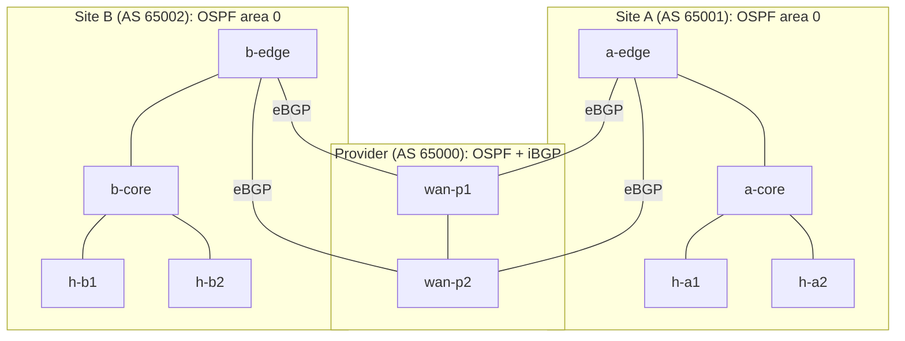
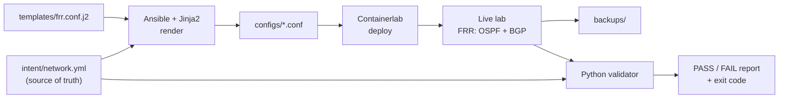

# netops-intent-lab

**Intent-based automation and validation for a dual-homed, two-site routed network,
built as code with Containerlab, FRRouting, Ansible and Python, and tested against
CCNA-level faults.**

| Result | Value |
|---|---|
| Deploy from nothing to a converged network | **~25 s** (one command, idempotent re-runs: `changed=0`) |
| Validation | **52 checks in ~9 s** (OSPF, BGP, routes, loopbacks, host reachability) |
| CCNA-level faults detected | **Validator 8/8 · ping-only test 4/8** |


## Engineering question
In a dual-homed two-site network, can automated **intent-based validation**
(desired state in YAML compared against live protocol state) detect and localise
faults that a ping-based check misses, and how fast is a full deploy → verify cycle?

**Answer (measured):** yes. Faults that break user traffic are visible to both, but
faults that remove redundancy or break the network's internals (a WAN link down,
a broken OSPF adjacency in the provider core, an unadvertised loopback) leave every
ping working. Only state validation caught them.

## The network



- **10 nodes:** 6 FRRouting routers and 4 Linux hosts, about 220 MiB of RAM in total.
- **Inside each site:** OSPF area 0, point-to-point links, passive host LANs,
  loopbacks advertised; the edge injects a default route towards the core.
- **Between sites and provider:** each edge is dual-homed to both provider routers
  with eBGP, announces one /16 summary and receives a default route.

Addressing plan, interface map and the reason behind each design choice:
[`docs/design.md`](docs/design.md).

## The pipeline



1. **Intent:** `intent/network.yml` describes every router as data (interfaces,
   OSPF, BGP, policies) plus the expected state. Nobody edits router configs by hand.
2. **Render and deploy:** `ansible/deploy.yml` renders one config per router from a
   Jinja2 template, builds the lab (or rebuilds it only if a config changed),
   waits for convergence and saves each router's running config to `backups/`.
3. **Validate:** `validator/validate.py` reads the same intent file, queries every
   router's live state as JSON (`vtysh ... json`) and checks:

| Checks | Count |
|---|---|
| OSPF neighbours Full (derived from the intent's subnets) | 6 |
| BGP sessions Established | 10 |
| Prefixes received from each BGP neighbour | 10 |
| Default route learned by OSPF on the cores | 2 |
| Every router loopback reachable from each site | 12 |
| Host-to-host reachability matrix | 12 |
| **Total** | **52** |

`--mode ping` runs only the 12 host-to-host pings: the **baseline**, i.e. what a
simple ping test sees.

## Fault campaign (CCNA level)
`faults/campaign.py` injects each fault, waits 50 s (longer than the OSPF dead
interval), runs the validator in both modes, repairs the fault and waits until
the network is healthy again.

| # | Fault | CCNA topic | Ping only | Validator |
|---|---|---|---|---|
| 1 | WAN link shut down | Interface status, redundancy | missed | detected |
| 2 | `passive-interface` on the provider core link | OSPF passive interfaces | missed | detected |
| 3 | MTU mismatch between OSPF neighbours | OSPF adjacency requirements | missed | detected |
| 4 | Hello timer mismatch (site A edge–core) | OSPF adjacency requirements | detected | detected |
| 5 | Area mismatch (site B edge–core) | OSPF areas | detected | detected |
| 6 | Missing `network` statement for a LAN | OSPF configuration | detected | detected |
| 7 | Missing `network` statement for a loopback | OSPF configuration | missed | detected |
| 8 | Wrong default gateway on a host | IP addressing | detected | detected |
| | **Total** | | **4/8** | **8/8** |

Full ledger: [`results/fault-ledger.md`](results/fault-ledger.md) · raw reports: `results/`.

**Validator v1 detected 7/8.** It missed fault 7 because it did not yet implement
the loopback-reachability part of the design; v2 added those 12 checks
([`results/fault-ledger-v1.md`](results/fault-ledger-v1.md)).

## Run it
Requirements: Linux or WSL2 with Docker and Containerlab, Python 3 with
`ansible-core` and `pyyaml`.

```bash
cd ansible && ansible-playbook deploy.yml     # build or repair the lab, converge, back up
cd .. && python3 validator/validate.py        # 52 checks, exit code 0 = healthy
python3 faults/campaign.py                    # the 8-fault campaign (~20 min)
```
After a WSL or PC restart, re-run `deploy.yml`: it detects the lost links and
rebuilds the lab.

## Repository layout
```
intent/      network.yml: the single source of truth
templates/   Jinja2 template for FRR configs
ansible/     deploy.yml (full deployment), render.yml (configs only)
configs/     generated router configs (do not edit)
topology/    Containerlab topology and viewer layout
validator/   Python validator (frr.py, checks.py, validate.py)
faults/      CCNA fault campaign
backups/     running configs saved after each deployment
results/     fault ledgers and validation reports
docs/        design document and images
```

## Design choices and limitations
- **Rebuild, don't patch:** a config change redeploys the lab. Simple and always
  reproducible here; a production network would receive only the differences.
- **Transport:** routers are reached with `docker exec`; real devices would use SSH
  or an API (NETCONF/RESTCONF), behind change management.
- **One-shot validation,** not continuous monitoring.
- **Not covered:** NAT and internet access, IPv6, firewalls, monitoring stack;
  WAN failover time was not measured.
- The four hosts are defined both in the topology file and in the intent file.

## What I would do in production
- A real source of truth (e.g. NetBox) instead of a YAML file.
- Run the validator automatically before and after every change (CI pipeline).
- BFD on WAN links, so a silently failed neighbour is detected in milliseconds
  instead of waiting for the BGP hold timer.
- A separate management VRF, so tests and management never use the data plane.

## Environment
Windows 11 · WSL2 · Containerlab 0.82.0 · Docker 27.5.1 · FRRouting 10.7.1 ·
ansible-core 2.19 · Python 3.11