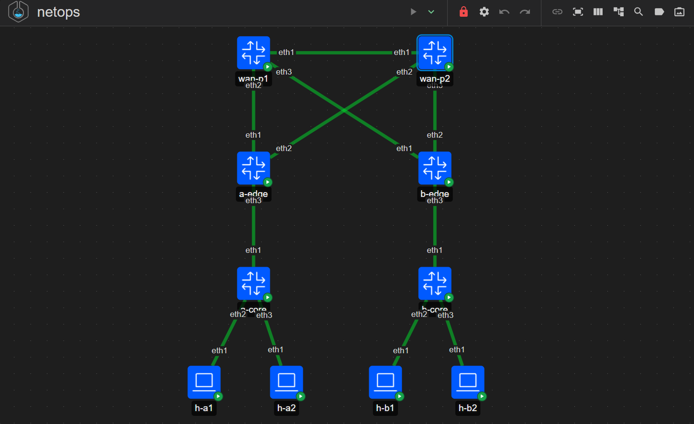
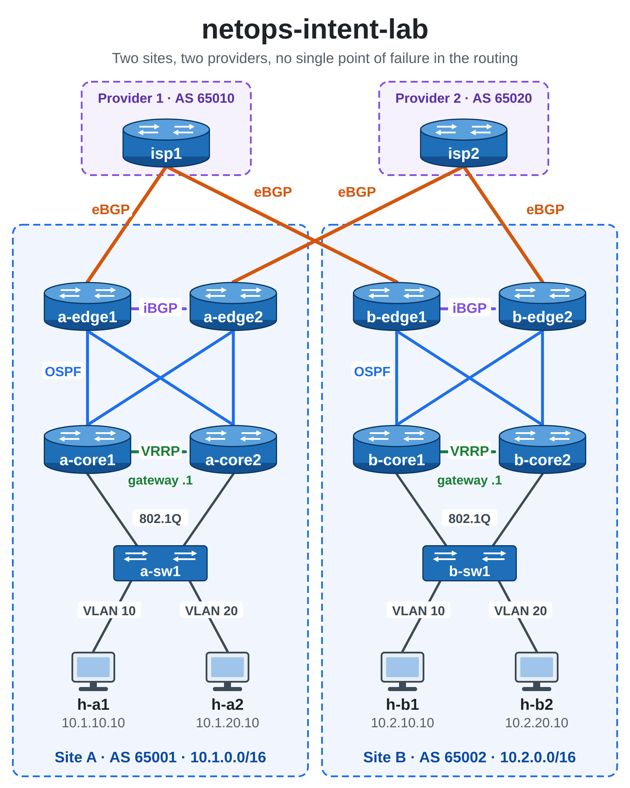

# netops-intent-lab

**Intent-based automation and validation for a fully redundant two-site network,
built as code with Containerlab, FRRouting, Ansible and Python, and tested against
CCNA-level faults.**

| Result (v2) | Value |
|---|---|
| Deploy from nothing to a converged network | **~[T] s** (one command, idempotent re-runs: `changed=0`) |
| Validation | **96 checks in ~[N] s** (OSPF, BGP, BFD, redundant paths, VRRP, reachability) |
| CCNA-level faults detected | **Validator [V]/9 · ping-only check [P]/9** |



## Engineering question
In a redundant two-site network, can automated **intent-based validation**
(desired state in YAML compared against live protocol state) detect and localise
faults that a ping-based check misses, and how fast is a full deploy → verify cycle?

**Answer (measured):** [to be written from the v2 fault ledger]

## The network



- **16 nodes:** 10 FRRouting routers, 2 access switches, 4 hosts.
- **Two independent providers** (AS 65010 and AS 65020); each site has **two edge
  routers**, one per provider, linked by iBGP.
- **Inside each site:** two core routers in a full OSPF mesh with both edges,
  **VRRP** as the hosts' redundant gateway, and an access switch carrying
  **VLANs 10 and 20** on 802.1Q trunks to both cores.
- **Network standards on every router:** OSPF MD5 authentication, BGP TCP-MD5
  passwords, BFD and a maximum-prefix limit on every eBGP session, OSPF passive
  by default.

Addressing plan, interface map and the reasoning behind each choice:
[`docs/design.md`](docs/design.md).

## The pipeline

```
intent/network.yml ─► Ansible + Jinja2 ─► configs/*.conf + topology ─► Containerlab ─► live lab
        │                                                                                  │
        └──────────────────────────► Python validator ◄────────────────────────────────────┘
                                            │
                               PASS/FAIL report + exit code
```

1. **Intent:** `intent/network.yml` describes every router, switch, host and cable
   as data, plus the expected state. Nobody edits configs or the topology by hand.
2. **Render and deploy:** `ansible/deploy.yml` renders the router configs **and the
   Containerlab topology** from Jinja2 templates, builds the lab (or rebuilds it
   only if something changed), waits for convergence and backs up each router's
   running config.
3. **Validate:** `validator/validate.py` reads the same intent file, queries every
   router's live state as JSON and checks:

| Checks | Count |
|---|---|
| OSPF neighbours Full (derived from the intent's subnets) | 16 |
| BGP sessions Established | 12 |
| Prefixes received from each BGP neighbour | 12 |
| BFD sessions up (eBGP, both sides) | 8 |
| Redundant routes: 2 equal-cost paths where the design has 2 | 12 |
| VRRP roles (Master/Backup) | 8 |
| Site router loopbacks reachable from each site | 16 |
| Host-to-host reachability matrix | 12 |
| **Total** | **96** |

`--mode ping` runs only the 12 host-to-host pings: the **baseline**, i.e. what a
reachability-only check (as used by simple ping monitoring) sees.

## Fault campaign (CCNA level)
`faults/campaign.py` injects each fault, waits 50 s (longer than the OSPF dead
interval), runs the validator in both modes, repairs the fault and waits until
the network is healthy again.

| # | Fault | CCNA topic | Ping only | Validator |
|---|---|---|---|---|
| 1 | WAN link shut down | Interface status, redundancy | | |
| 2 | `passive-interface` on a router-to-router link | OSPF passive interfaces | | |
| 3 | MTU mismatch between OSPF neighbours | OSPF adjacency requirements | | |
| 4 | Hello timer mismatch | OSPF adjacency requirements | | |
| 5 | Area mismatch | OSPF areas | | |
| 6 | Missing `network` statement for a VLAN | OSPF configuration | | |
| 7 | Missing `network` statement for a loopback | OSPF configuration | | |
| 8 | Wrong default gateway on a host | IP addressing | | |
| 9 | Active gateway loses its LAN link | First-hop redundancy (VRRP) | | |
| | **Total** | | **[P]/9** | **[V]/9** |

Full ledger: [`results/fault-ledger.md`](results/fault-ledger.md).

### History: v1
v1 had one provider and one edge and one core per site. Its campaign (8 faults)
gave **validator 8/8, ping 4/8**; validator v1 first scored 7/8 and missed an
unadvertised loopback, which led to the loopback checks. A review of v1 found
single points of failure everywhere outside the WAN, which v2 removes.
v1 results: [`results/archive-v1/`](results/archive-v1/).

## Run it
Requirements: Linux or WSL2 with Docker and Containerlab, Python 3 with
`ansible-core` and `pyyaml`; kernel support for 802.1Q VLANs, macvlan and TCP-MD5.

```bash
cd ansible && ansible-playbook deploy.yml     # build or repair the lab, converge, back up
cd .. && python3 validator/validate.py        # 96 checks, exit code 0 = healthy
python3 faults/campaign.py                    # the 9-fault campaign (~25 min)
```
After a WSL or PC restart, re-run `deploy.yml`: it detects the lost links and
rebuilds the lab.

## Repository layout
```
intent/      network.yml: the single source of truth (routers, switches, hosts, cabling)
templates/   Jinja2 templates: FRR configs and the Containerlab topology
ansible/     deploy.yml (full deployment), render.yml (render only)
configs/     generated router configs (do not edit)
topology/    generated Containerlab topology (do not edit)
validator/   Python validator (frr.py, checks.py, validate.py)
faults/      CCNA fault campaign
backups/     running configs saved after each deployment
results/     fault ledgers and validation reports (v1 archived)
docs/        design document and images
```

## Scope and assumptions
- **One access switch per site:** the last single point of failure for the hosts.
- **Out of scope:** internet edge and NAT, firewalls, wireless, remote access, IPv6, QoS.
- **Management plane:** routers are reached with `docker exec`; no NTP, syslog, AAA or SNMP.
- **Lab-only secrets:** the authentication keys are plain values in the intent file.

## Design choices and limitations
- **Rebuild, don't patch:** a change redeploys the lab. Simple and always
  reproducible here; a production network would receive only the differences.
- **Transport:** routers are reached with `docker exec`; real devices would use SSH
  or an API (NETCONF/RESTCONF), behind change management.
- **One-shot validation,** not continuous monitoring. WAN failover time was not measured.

## What I would do in production
- A switch stack or a second access switch per site.
- An out-of-band management network with NTP, syslog, TACACS+ and SNMPv3.
- Secrets in a vault (e.g. Ansible Vault), a real source of truth (e.g. NetBox),
  /31 point-to-point links.
- Run the validator before and after every change (CI pipeline).

## Environment
Windows 11 · WSL2 · Containerlab 0.82.0 · Docker 27.5.1 · FRRouting 10.7.1 ·
ansible-core 2.19 · Python 3.11
